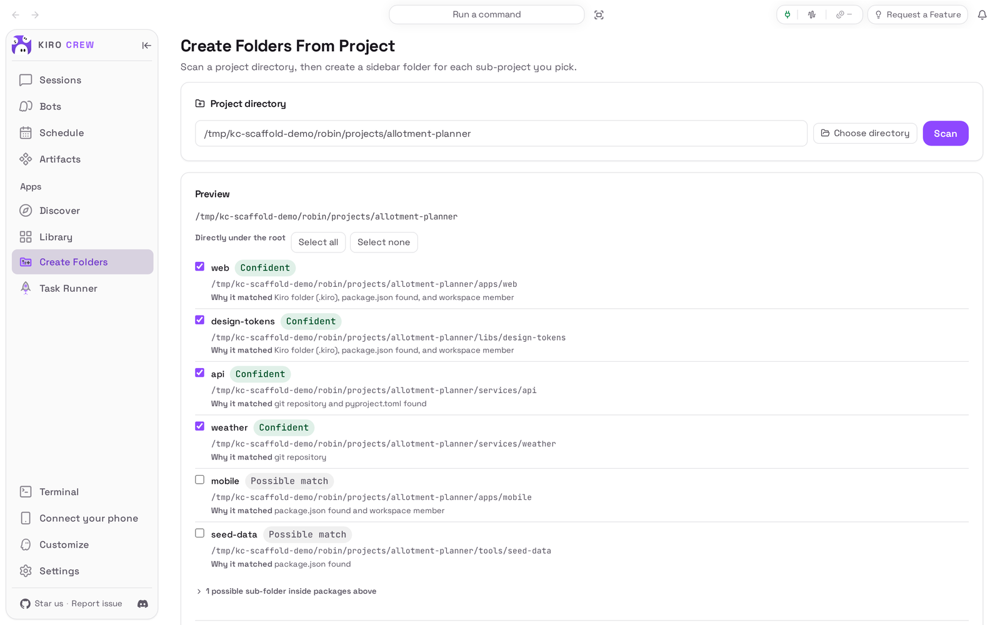
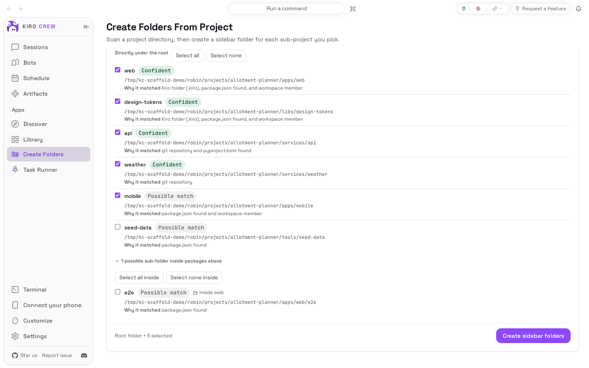
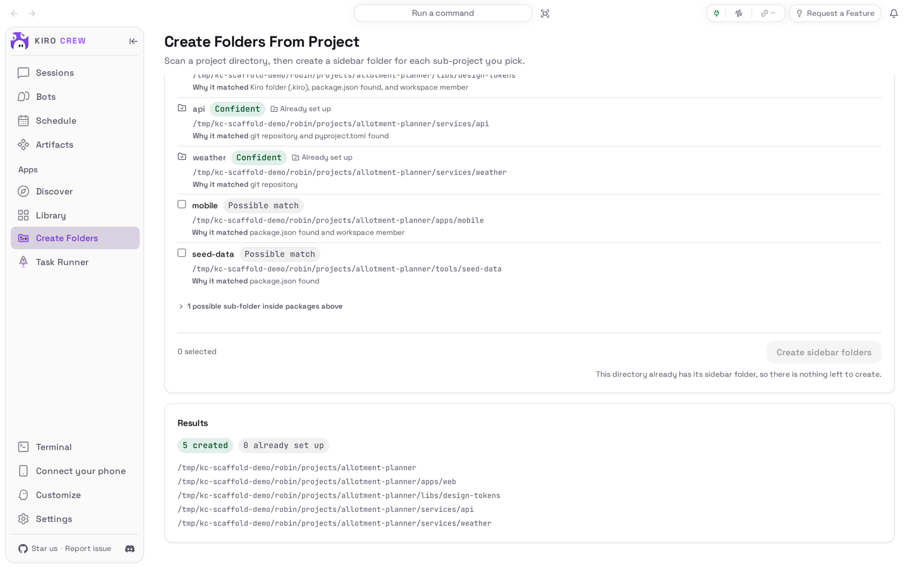

# Create Folders From Project

<picture>
  <source media="(prefers-color-scheme: dark)" srcset="docs/media/hero-dark.png">
  
</picture>

**Turn one project directory into a sidebar folder for each of its sub-projects.**

Create Folders From Project is an app for [Kiro Crew](https://github.com/kirodotdev/KiroCrew),
the open-source personal AI agent.

## What it is

Once it is on, **Create Folders** appears under **Apps** in the sidebar. You give
it a project directory, it works out which sub-projects live inside (git
repositories, folders with a `.kiro` folder, packages with a manifest such as
`package.json` or `pyproject.toml`), and shows them as a list you tick. When you
confirm, it creates one sidebar folder for the project and one for each sub-project
you ticked, nested the way they are on disk.

**Get started:** it comes with Kiro Crew, switched off: open **Apps → Library**,
choose **Show N disabled apps**, and pick **Enable** in the **⋯** menu on the
**Create Folders From Project** tile. See [Install](#install) for the details.

## The problem it solves

You work in a big repository, or in a directory that holds several repositories
side by side, and you want each part to have its own sidebar folder, so the chats
you start there pick up that part's own steering and stay grouped together.
Making those folders by hand means one dialog per package and remembering which
ones you already made. This page looks at the directory once, shows you what it
found and why, and creates exactly the folders you tick. It never creates
anything before you press the button, and it never creates a folder you already
have.

## Top 3 use cases

### 1. Set up a monorepo in one go

You have just cloned a workspace with web and mobile apps, a few services and a
shared design library. You open **Create Folders**, type or choose the project
directory and press **Scan**. The preview ticks the confident matches (the git
repositories and the folders that already have a `.kiro` folder) and offers the
rest unticked, each with a line saying why it matched. You tick the extra
package you want and press **Create sidebar folders**.


### 2. Decide about the folders hidden deeper down

Some packages keep another manifest further down, for example an end-to-end test
setup with its own `package.json`. Those are rarely worth a folder, so the
preview keeps them in one collapsed group under the main list, with a count. You
open it, see the `e2e` folder inside `web`, and leave it unticked, or tick it if
you do want a folder for it.



### 3. See exactly what was created, and run it again safely

After **Create sidebar folders**, a **Results** card lists every folder that was
created, every one that already existed, and anything that failed with the
reason. The preview updates in place, so the rows you just created now say
**Already set up**. Scanning the same directory again later, after a new package
has appeared, offers only the new one.



## Watch it


[Watch the walkthrough as a video (MP4)](docs/media/walkthrough.mp4).

<sub>Recorded from a real Kiro Crew on a throwaway home with a made-up project
folder written for the demo (see `capture/demo_tree.py`). No AI model is involved:
the page scans the directory and creates folders itself. Short waits between steps
were added so each screen can be read.</sub>

## Install

**Today: Create Folders From Project comes with Kiro Crew.** Nothing needs
downloading. It starts switched off:

1. In Kiro Crew, open **Apps → Library** in the left sidebar.
2. Choose **Show N disabled apps** (N is how many apps are switched off).
3. On the **Create Folders From Project** tile, open the **⋯** menu and choose
   **Enable**.
4. **Create Folders** now appears under **Apps** in the sidebar.

When a Kiro Crew release moves your copy over to this repository's copy, it does
so by itself: the app stays on, keeps its place in the sidebar, and the folders
you made are untouched.

**Coming later: from the Kiro Crew App Store.** Once this app is listed there:

1. Open **Apps → Discover** in the left sidebar.
2. Search for **Create Folders From Project** and choose **Install**.
3. Kiro Crew asks **Trust “Create Folders From Project” to run its own code?**
   The app's page is a small program of its own that runs inside the Kiro Crew
   dashboard. Trusting it gives that program the same access Kiro Crew has (your
   files, your saved sign-ins and the internet), as the dialog says. If you are
   happy with that, choose **Trust this app**. You can take it back later in
   **Settings → Security → Third-party apps**.
4. The app installs switched off. Choose **Enable** on its page.

What you need: Kiro Crew on a Mac, Linux or Windows computer, in the desktop app
or a browser. No accounts or keys are needed. The **Choose directory** button
opens the same project picker the sidebar's folder settings use; on a Kiro Crew
too old to offer that picker to apps, the button is not shown and you type the
path instead.

## First run

The page opens with one empty field, **Project directory**. Type the absolute
path of a project directory, or press **Choose directory** to pick one from your
favourites, your recent projects or by browsing, then press **Scan**. Nothing is
created until you press the create button under the preview.

## How to use it

1. Open **Create Folders** from **Apps** in the sidebar.
2. Fill in **Project directory** (type it, or **Choose directory**) and press
   **Scan**.
3. Read the **Preview**: **Confident** rows start ticked, **Possible match** rows
   do not, and **Why it matched** says what was found. Use **Select all** or
   **Select none** for the main list. Open **possible sub-folders inside packages
   above** to see deeper finds, which have their own select buttons.
4. Press **Create sidebar folders** (or **Create the root folder only** when
   nothing is ticked). The project's own folder is always created unless it
   already exists.
5. Read the **Results** card. The new folders are in the sidebar right away.

## Settings & data

- **Where your data lives:** the app keeps no data of its own. The folders it
  creates are ordinary sidebar folders, stored with Kiro Crew's own chat folders,
  and you rename, move or delete them there like any other folder.
- **What leaves your computer:** nothing. The scan reads the directory on the
  computer running Kiro Crew, and creating a folder only writes Kiro Crew's own
  folder list.
- **What it reads:** the directory you scan, up to five levels down. It skips
  build and dependency folders (such as `node_modules`), and refuses a path Kiro
  Crew treats as sensitive, the same way creating a folder by hand does.
- **Turn it off:** **Apps → Library**, open the **⋯** menu on Create Folders From
  Project, choose **Disable**. The folders it created stay.
- **Remove it:** the same menu, **Uninstall**. The folders it created stay too.

## Troubleshooting / FAQ

**The page says the project directory must be an absolute path, or must be an
existing directory.**
Type the full path starting from the top of the disk (for example
`/Users/you/code/my-project`, or `C:\code\my-project` on Windows), or press
**Choose directory** and pick it. The message is the same one creating a folder
by hand shows.

**"This preview no longer matches the directory on disk."**
Something changed in the directory after you scanned it (a package was added,
moved or deleted). Press **Re-scan** and tick your choices again; nothing was
created.

**The page says the directory above changed and asks you to scan it first.**
You edited the **Project directory** field after the scan, so the preview is for
a different directory. Press **Scan** again.

**A sub-project I expected is missing.**
The scan looks five levels down and skips build and dependency folders. A
directory with no git repository, no `.kiro` folder and no package manifest is
not offered. You can still create a folder for it by hand from the sidebar.

**A row says Already set up and has no tick box.**
A sidebar folder for that directory already exists, so it is never created twice.

**The page says the app is not enabled.**
Open **Apps → Library** and choose **Enable** on Create Folders From Project.

## Development

The app is a dashboard page and a manifest. It has no backend: the scan and the
folder creation are Kiro Crew's own endpoints (`POST /api/project-scaffold/scan`
and `/create`), and the page calls them through the App SDK's scoped client.
[PORTING.md](PORTING.md) records how this copy differs from the built-in it was
ported from.

| Path | What |
|---|---|
| `app.json` | The manifest |
| `ui/src/` | The page (`ProjectScaffolderPage.tsx`), its request client (`api.ts`) and strings (`i18n.ts`) |
| `ui/i18n/` | The page's strings in every language Kiro Crew ships |
| `ui/dist/index.mjs` | The committed bundle Kiro Crew loads; CI rebuilds it and fails on a difference |
| `tests/` | The manifest and tree contract |
| `capture/` | The README pictures and recording |

### Install from a clone

```bash
git clone https://github.com/KiroCrewCaptain/kirocrew-app-project-scaffolder
kirocrew app install ./kirocrew-app-project-scaffolder
kirocrew app enable project-scaffolder
```

`kirocrew app enable` is refused with `app_execution_denied` until the app is
trusted, and there is no command-line trust step. Enable it from **Apps → Library**
instead: that opens the trust dialog, and **Trust this app and enable** does both.
`kirocrew app disable project-scaffolder` turns it off;
`kirocrew app uninstall project-scaffolder` removes it.

### Tests

```bash
python -m pip install -r tests/requirements.txt
python -m pytest

cd ui
npm ci
npm run typecheck
npm test
npm run build   # rewrites ui/dist/index.mjs; CI fails if it differs from the commit
```

The tests need no Kiro Crew install and no network.

### Re-capture the README media

The pictures and the recording come from a real, isolated Kiro Crew gateway
driven by [`capture/`](capture/README.md). The page scans a directory on disk, so
its demo project is written by `capture/demo_tree.py` and the gateway runs with
`HOME` pointing at the made-up home beside it:

```bash
python capture/demo_tree.py /tmp/kc-scaffold-demo
HOME=/tmp/kc-scaffold-demo/robin python capture/capture.py --kirocrew /path/to/KiroCrew
python capture/check_readme.py
```

With `HOME` changed, set `PLAYWRIGHT_BROWSERS_PATH` to your real browser cache
for the run. Then look at every image and at a few frames of the video before
committing (see [CHECKLIST.md](CHECKLIST.md)).

## License

Apache License 2.0. See [LICENSE](LICENSE) and [NOTICE](NOTICE).
